<div align="center">


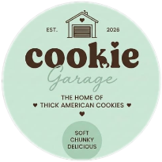

<br/>

<a href="https://www.instagram.com/cookiegarageee/">
  
</a>

<br/>


<a href="https://www.instagram.com/cookiegarageee/"></a>

</div>

---

## 🍪 About

**Cookie Garage** is a home bakery serving big, soft, chunky **thick American cookies** — freshly baked, eggless and made with love.
This repo is the **first-draft prototype** of their website: a light, jolly, single-page front end where people can discover the cookies and order through Instagram.

<div align="center">
  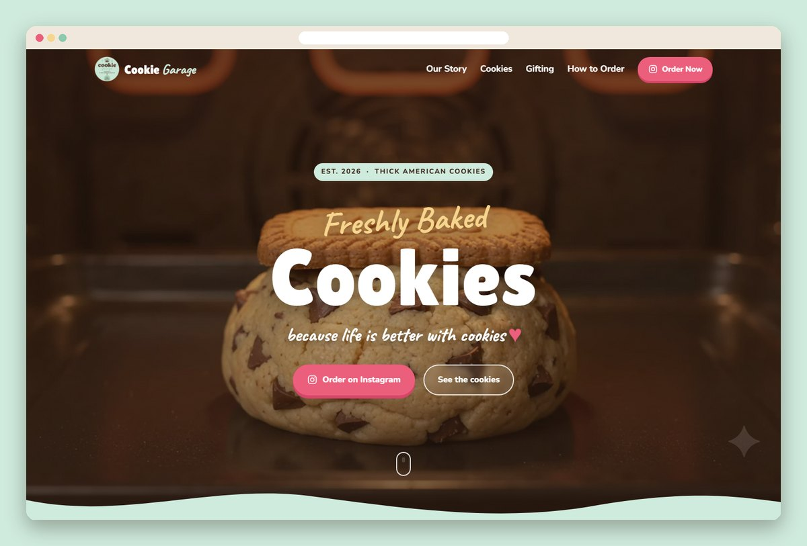
</div>

---

## 🎬 Fresh out of the oven

The hero section plays a looping background video of a cookie baking, with a Biscoff topping and a caramel pour.

<div align="center">
  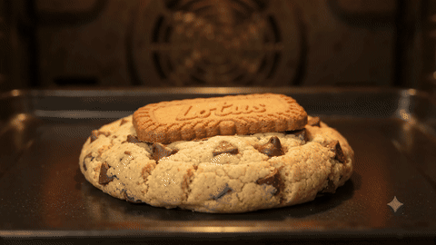
</div>

---

## ✨ Take a tour

<div align="center">
  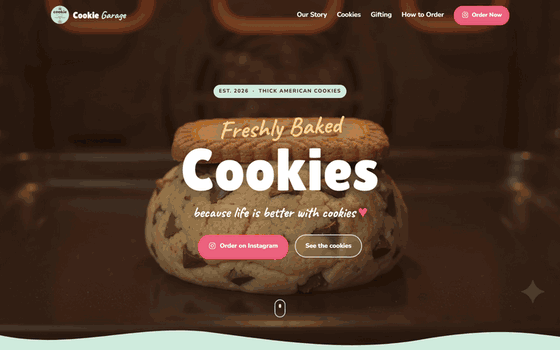
</div>

---

## 🧁 Meet the cookie crew

<div align="center">
<table>
  <tr>
    <td align="center">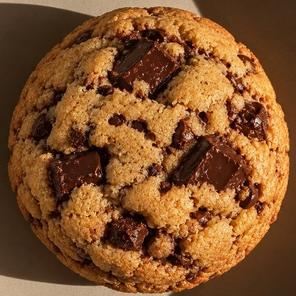<br/><b>Choco Chunk</b></td>
    <td align="center">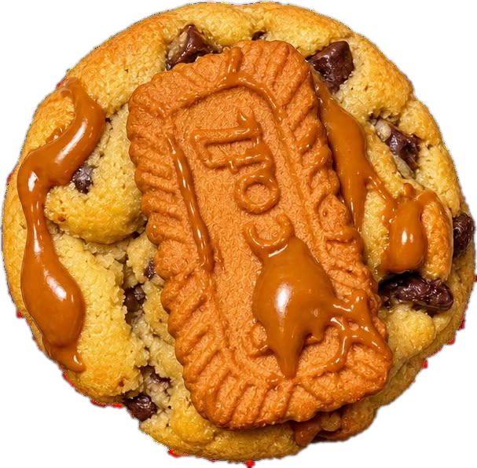<br/><b>Biscoff Lava</b></td>
    <td align="center">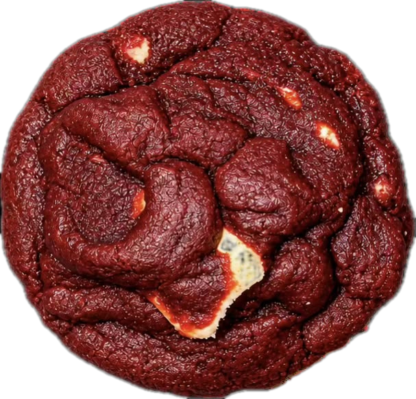<br/><b>Red Velvet</b></td>
    <td align="center"><br/><b>Classic Butter</b></td>
  </tr>
</table>
</div>

---

## 🖼️ Sections

| Our Story | The Cookies |
|:---:|:---:|
| 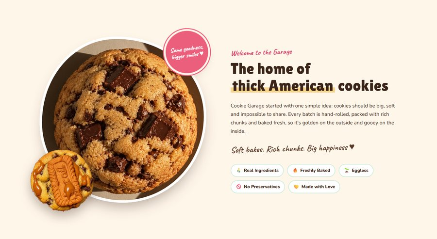 | 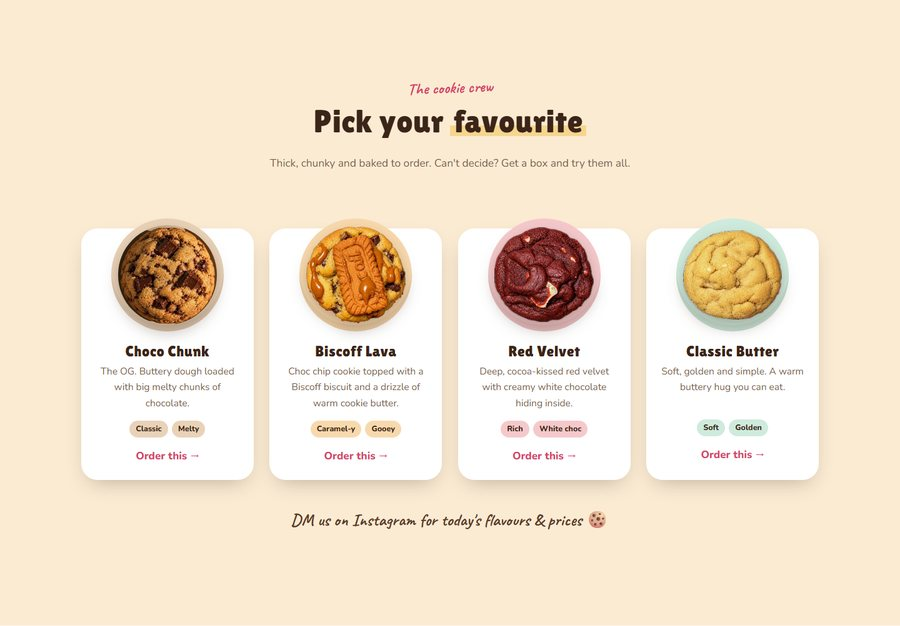 |
| **Gifting** | **How to Order** |
| 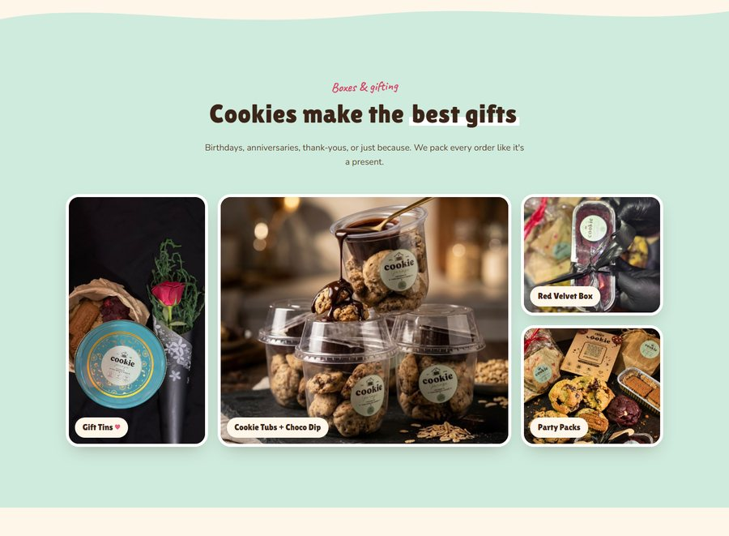 | 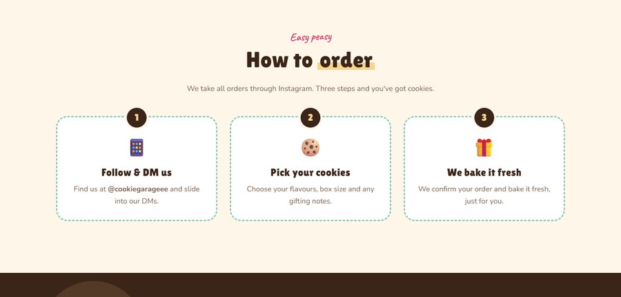 |

<div align="center">
  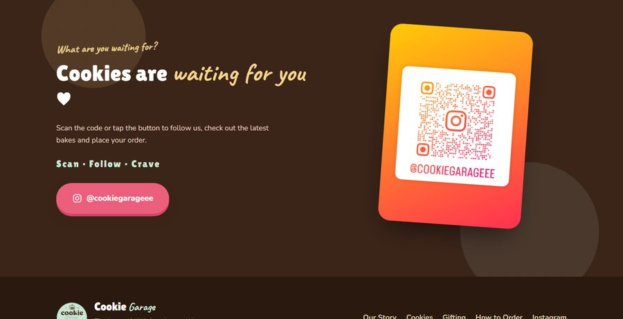
</div>

---

## 📱 Looks great on phones too

<div align="center">
  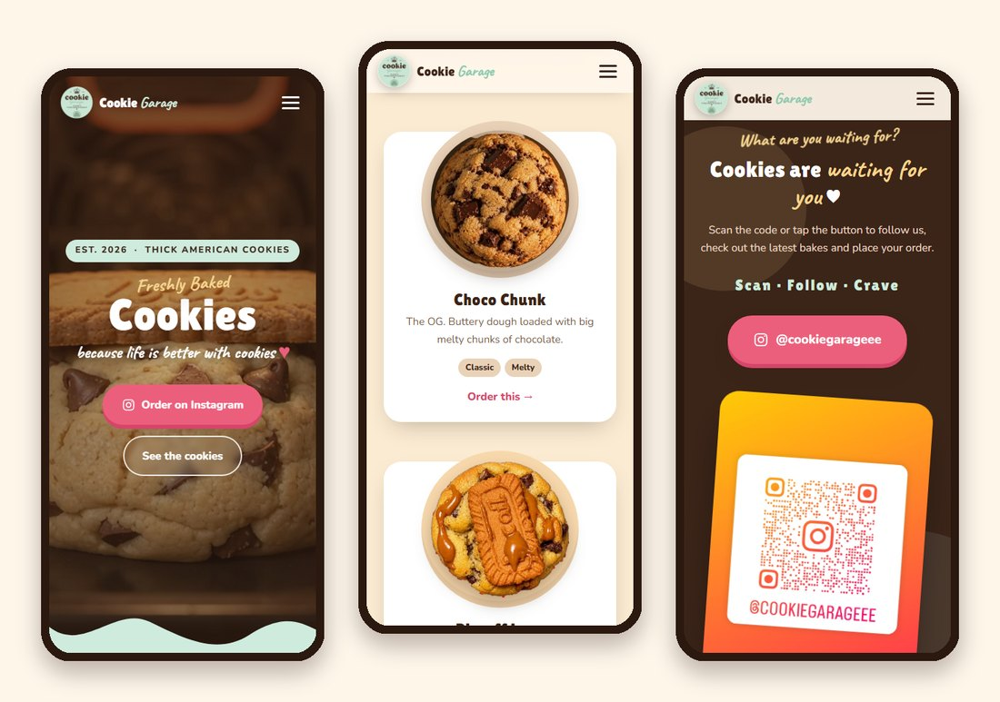
</div>

---

## 🌟 Features

- 🎥 **Video hero:** a full-screen cookie-baking loop with a soft chocolate overlay
- 🍬 **Jolly brand theme:** mint, chocolate and cream colours taken from the logo, with chunky and handwritten fonts
- 🪄 **Light animations:** fade-up on scroll, a floating cookie, a wobbly sticker, a scrolling ribbon and hover wiggles
- ♿ **Reduced motion:** all animation switches off when the visitor's device asks for it
- 📱 **Fully responsive:** a hamburger menu and stacked layouts on mobile
- 📸 **Instagram ordering:** every "Order" button and the QR code lead to [@cookiegarageee](https://www.instagram.com/cookiegarageee/)
- ⚡ **Zero build step:** plain HTML, CSS and JS

---

## 🚀 Run locally

```bash
git clone https://github.com/HaRsH00000007/Cookie_Garage_Prototype.git
cd Cookie_Garage_Prototype
python -m http.server 5500
```

Then open **http://localhost:5500** 🍪

## 📂 Structure

```
index.html        page markup
css/style.css     styles + light animations
js/main.js        sticky nav, mobile menu, scroll reveal
assets/images/    logo, product & gifting photos, Instagram QR
assets/video/     hero background video
docs/             README screenshots & GIFs
```

---

<div align="center">

### What are you waiting for? Cookies are waiting for you ♥

<a href="https://www.instagram.com/cookiegarageee/">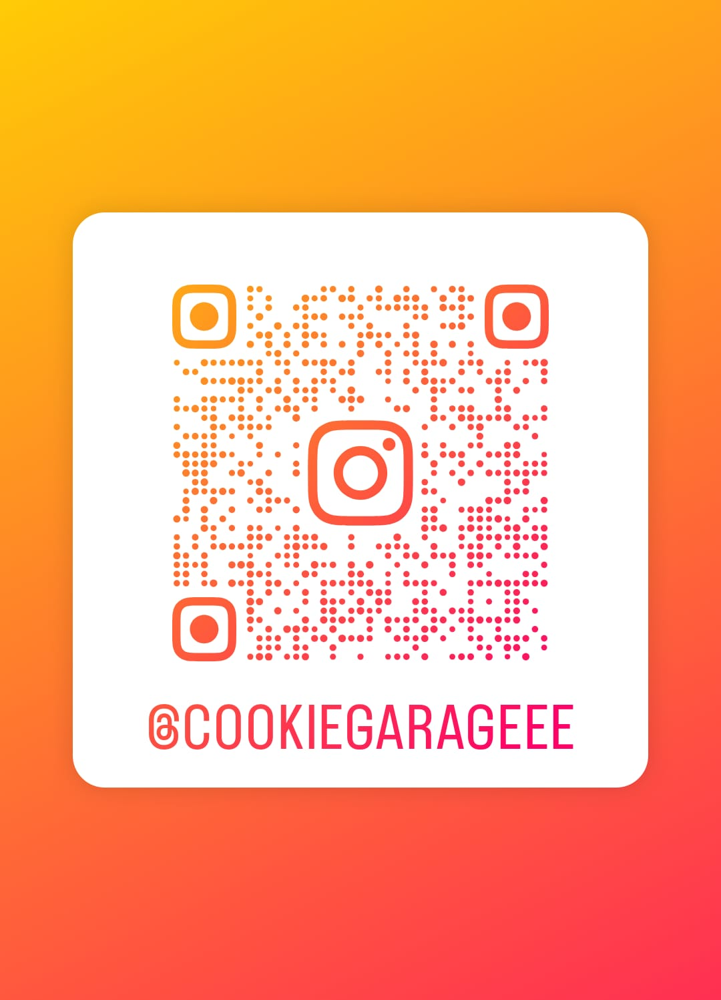</a>

**Scan · Follow · Crave**


</div>
